# 晶晶體注音

Mac 的注音輸入法，中文和英文可以混著打，不用切換輸入法。

## 系統需求

- macOS 14 以上
- Apple 晶片（M1 以後）或 Intel 的 Mac 都可以

## 下載

[下載安裝檔（JingJingType.pkg）](https://github.com/TimJi/jingjingtype-releases/releases/latest/download/JingJingType.pkg)

連結永遠是最新一版。以前的版本在 [Releases](https://github.com/TimJi/jingjingtype-releases/releases)。

## 安裝

這個輸入法是個人做的，沒有付費給 Apple 做公證，所以第一次打開安裝檔時，macOS 會說「Apple 無法驗證是否為惡意軟體」並擋下來。這是因為 Apple 沒有檢查過它，不是發現了問題。照下面的步驟可以打開，每台 Mac 只要做一次，之後的更新不會再擋。

1. 打開下載的 JingJingType.pkg。macOS 說「未打開「JingJingType.pkg」」時，按「完成」，不要按「丟到垃圾桶」。

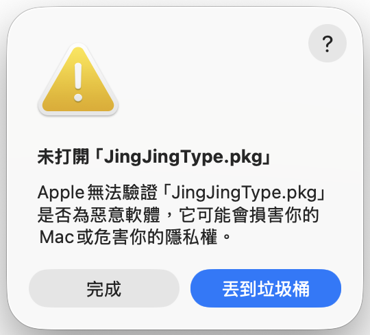

2. 打開「系統設定」→「隱私權與安全性」，捲到下面的「安全性」。在「已阻擋「JingJingType.pkg」以保護你的 Mac。」旁邊按「強制打開」。

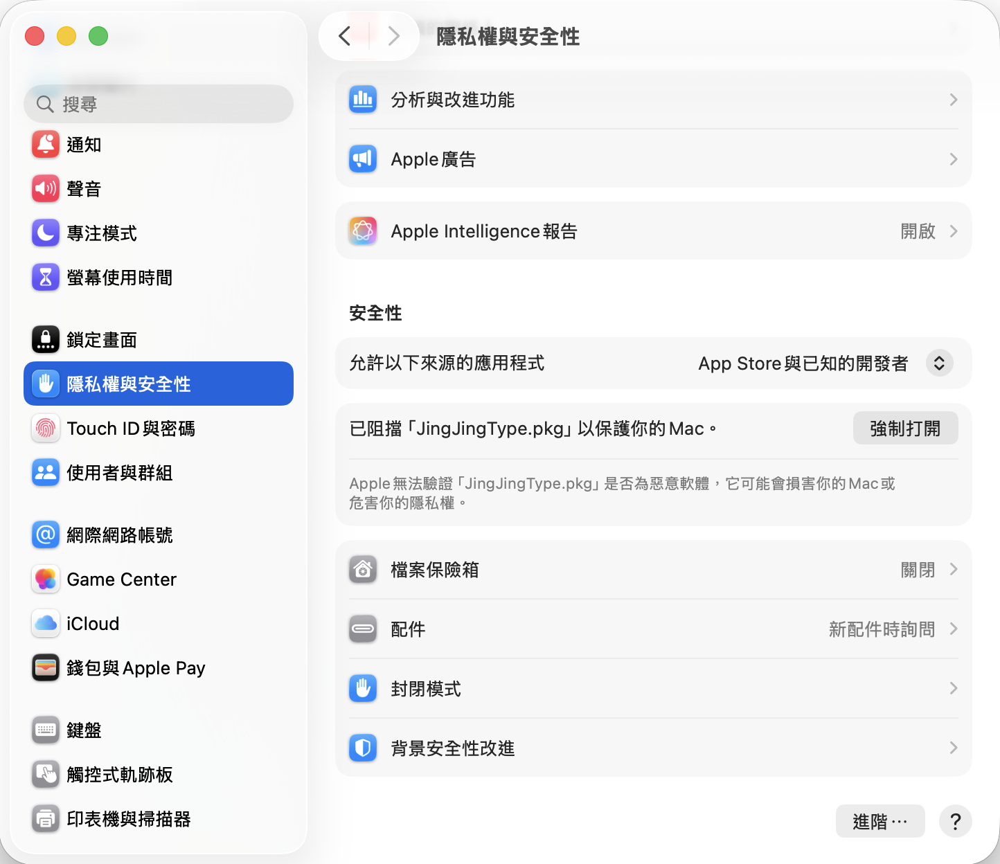

3. 再問「要打開「JingJingType.pkg」嗎？」時，按「強制打開」。

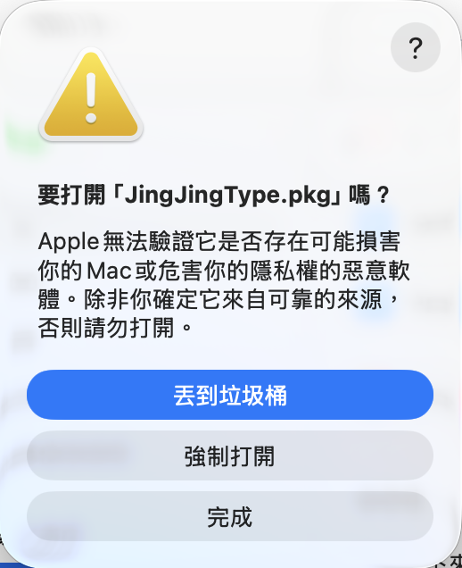

4. 輸入這台 Mac 的登入密碼，或用 Touch ID。你的帳號不是管理者的話，要輸入管理者的名稱和密碼。

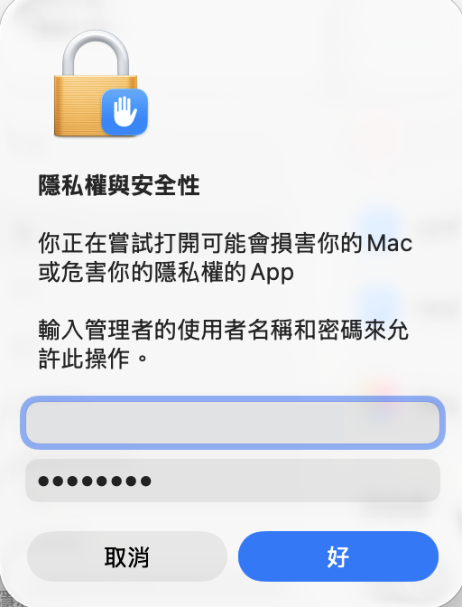

5. 安裝程式打開後，按「繼續」，再按「安裝」。只會裝給你自己這個帳號。

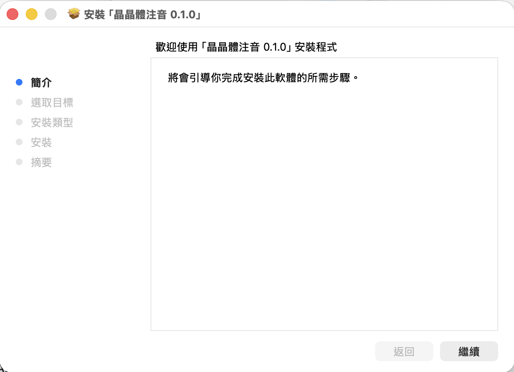
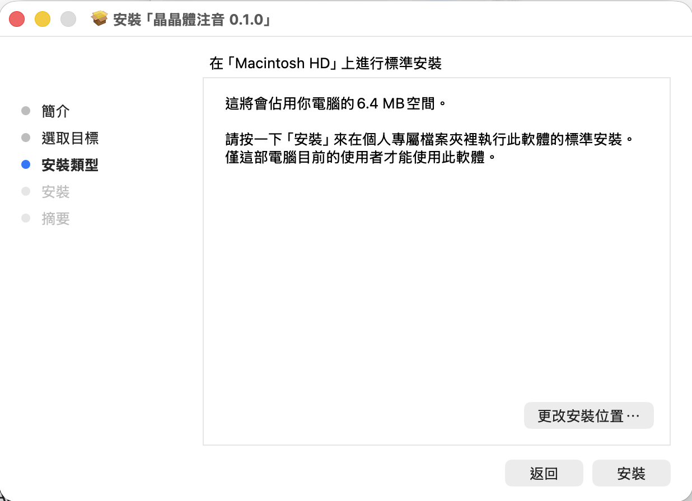

6. 系統問「要允許「晶晶體注音安裝程式」啟用「晶晶體注音」嗎？」時，按「允許」。這是安裝程式在幫你把晶晶體注音加進輸入方式。

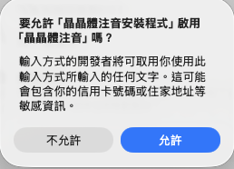

7. 看到「已成功安裝」，按「關閉」。接著問要不要把安裝程式丟到垃圾桶，兩個都可以。

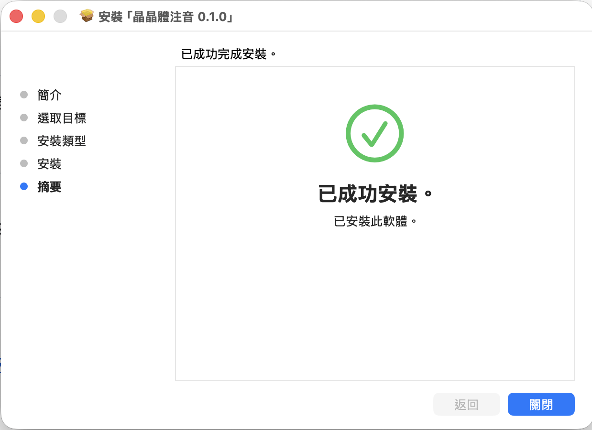

## 開始打字

裝好以後，選單列的輸入法選單會出現「晶晶體注音」。

- 切換：按 ⌃ 空白鍵（control 加空白鍵），或從選單列的輸入法選單選「晶晶體注音」。
- 鍵盤排列是標準注音（大千）：例如按 su3cl3 打出「你好」。

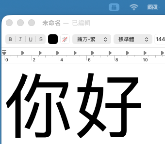
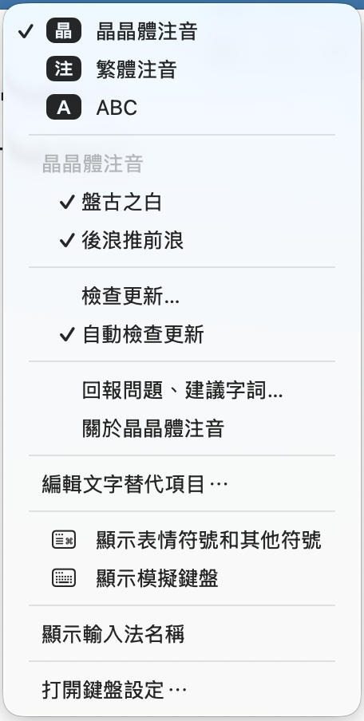

選單裡找不到「晶晶體注音」的話：

1. 登出再登入（蘋果選單 →「登出」）。
2. 打開「系統設定」→「鍵盤」，在「文字輸入」按「輸入方式」旁的「編輯…」。
3. 按左下角的「＋」，選「繁體中文」→「晶晶體注音」，按「加入」。

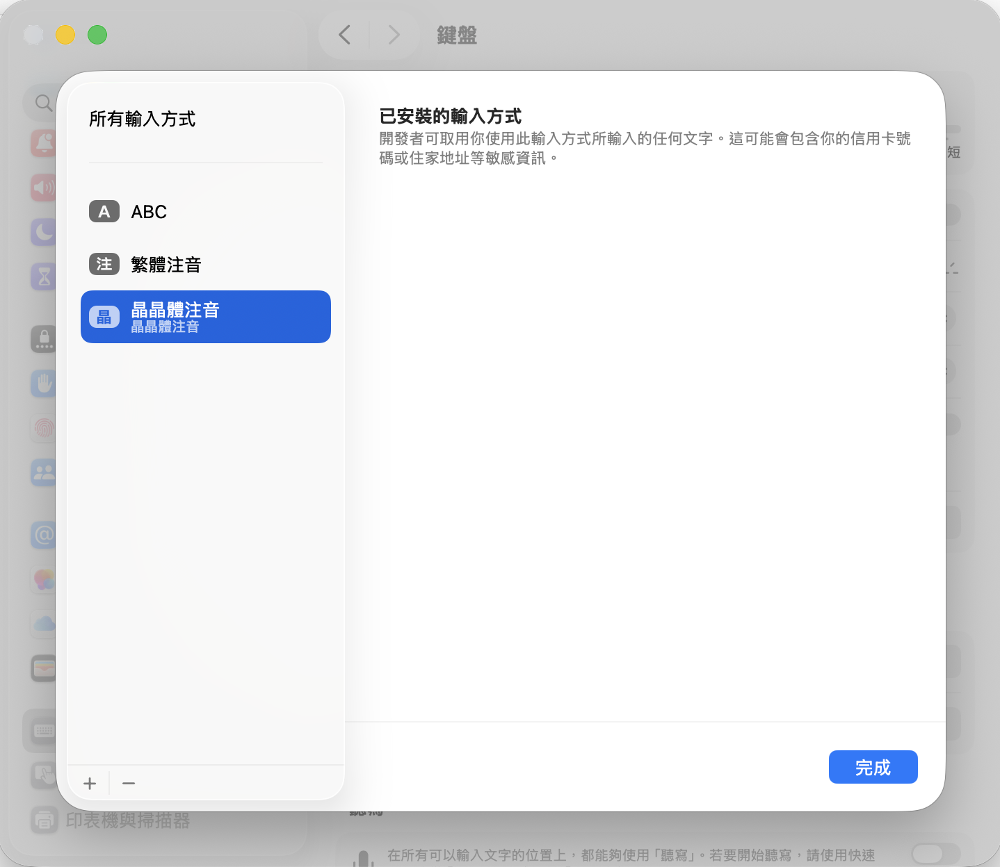

## 輸入法選單裡的設定

- 盤古之白：中文和英文、數字之間自動加一個半形空白。
- 後浪推前浪：打後面的字時，前面的字會跟著換成更合適的詞。關掉的話，已經出現的字不會再變。
- 關於晶晶體注音：看版本號、詞庫的出處與授權。

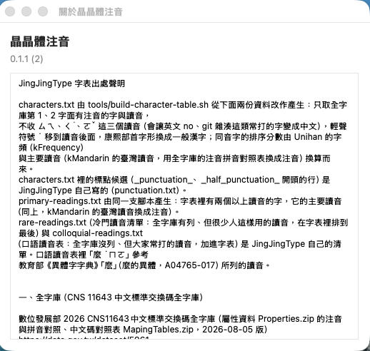

## 更新

有新版時，通知中心會出現「晶晶體注音有新版」。第一次跳通知前，macOS 可能會問要不要允許晶晶體注音傳送通知，選「允許」。

1. 按通知，或從輸入法選單選「檢查更新…」，會打開更新視窗，裡面寫著這一版改了什麼。按「安裝更新項目」。

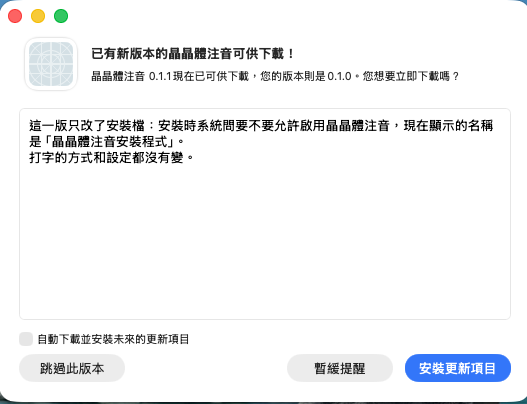

2. 下載好以後按「安裝並重新啟動」。選字習慣和設定都會留著。

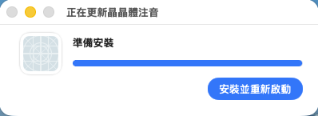

不想自動檢查的話：輸入法選單 → 取消勾選「自動檢查更新」。

## 回報問題、建議字詞

打出來的字不對、打不出想要的字、覺得哪裡怪怪的，都可以回報：

- 輸入法選單 →「回報問題、建議字詞…」，會打開表單並自動填好版本號。
- 或直接打開[回報表單](https://docs.google.com/forms/d/e/1FAIpQLSeQ74DTcWPjAgJ3ts34SgnHZyFfp1iPCu1Uhax9tKsfb0nzkw/viewform)。

表單只會收到你在表單裡寫的內容和輸入法的版本號，不需要登入，也不會收到你平常打的字。

## 隱私

- 輸入法本身不連網，看得到你打字的程式不會把任何東西送出去。
- 只有負責更新的服務會連到 GitHub，下載版本資訊和更新檔。
- 選字習慣只存在你的 Mac。

## 移除

1. 打開「系統設定」→「鍵盤」→「輸入方式」旁的「編輯…」，選「晶晶體注音」，按左下角的「－」。
2. 在 Finder 按 ⇧⌘G（前往檔案夾），輸入 `~/Library/Input Methods`，把 JingJingType.app 丟到垃圾桶。
3. 想連選字習慣一起刪掉的話，再前往 `~/Library/Containers`，把 com.timji.inputmethod.JingJingType（Finder 可能顯示成「晶晶體注音」）丟到垃圾桶。不刪的話，之後重裝會接著用。
